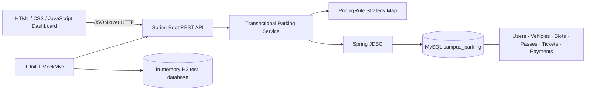
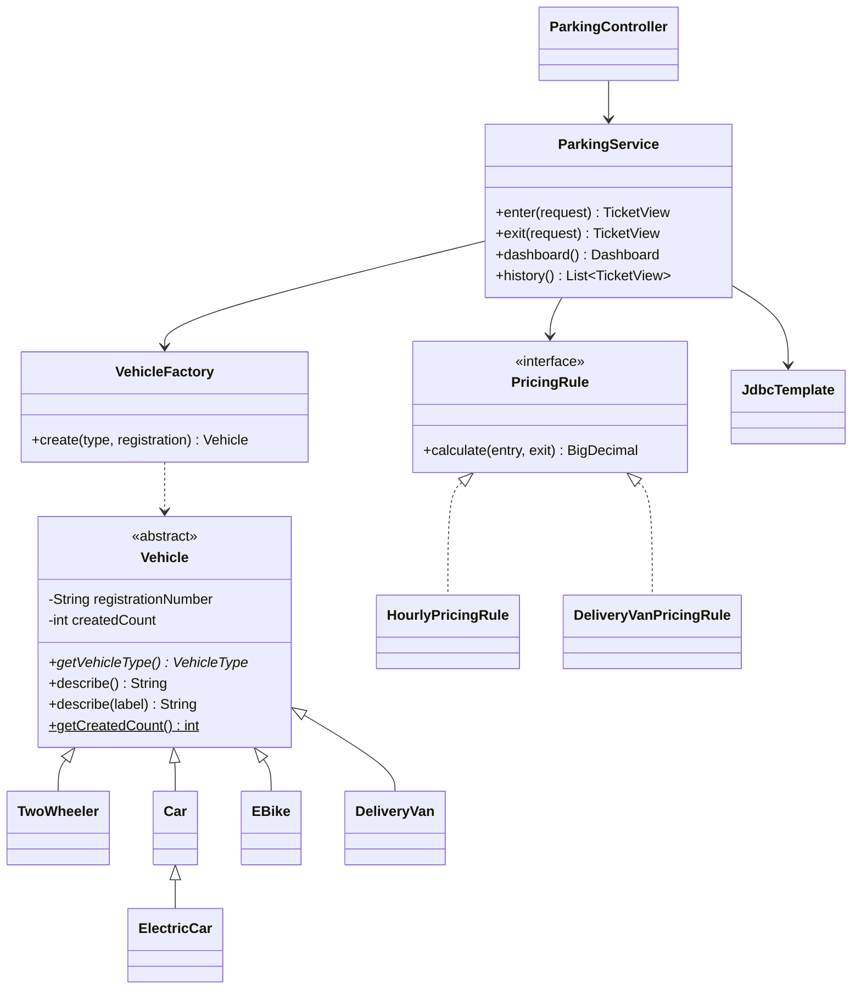

# Campus Smart-Parking System

A beginner-friendly, five-floor campus parking application built with Java 17, Spring Boot, JDBC, MySQL, and a responsive HTML/CSS/JavaScript dashboard.

> The official 12-page `ASSIGNMENT 1.pdf` was read. The exact task-wise academic submission, including the two completed PDF programs, is in [JAVA-ASSIGNMENT-1](JAVA-ASSIGNMENT-1/README.md). Replace student and GitHub placeholders before submission.

## Features

- Five floors with independently configurable slot counts; default layout is 8, 10, 12, 10, and 8 spaces.
- Vehicle types: two-wheeler, car, electric car, e-bike, and delivery van.
- Student, staff, and visitor accounts, with monthly and one-day passes.
- Automatic space allocation by slot class, unique UUID tickets, entry/exit, occupancy release, history, and reports.
- Passes waive parking fees only when they cover the complete parking session. EV charging remains payable.
- Hourly billing charges every started hour, with a one-hour minimum. The e-bike flat rate is configurable.
- Delivery vans pay twice the car rate for billable hour segments beginning from 9:00 through 16:59; other segments use the car rate.
- MySQL-backed CRUD endpoints for vehicles, users, parking slots, and passes; tickets and payment records are persisted as part of entry/exit workflows.
- Java tests use an in-memory H2 database and do not require a running MySQL server.

## Requirements

- JDK 17+
- Apache Maven 3.9 or later
- MySQL 8.x

## Run locally (Windows PowerShell)

1. Install and start MySQL. The default configuration connects as `root` with an empty password and creates the `campus_parking` database automatically. Change credentials if needed:

   ```powershell
   $env:DB_USERNAME = "root"
   $env:DB_PASSWORD = "your-local-mysql-password"
   ```

2. From the project root, run the automated tests:

   ```powershell
   mvn test
   ```

3. Start the application:

   ```powershell
   mvn spring-boot:run
   ```

4. Open `http://localhost:8080` in a browser. The frontend is served by Spring Boot; no separate Node.js server is needed.

The database URL, username, and password can also be set with `DB_URL`, `DB_USERNAME`, and `DB_PASSWORD`. The configurable e-bike fee is `EBIKE_FLAT_FEE` (default ₹15). Set `PARKING_FLOOR_SLOTS` to five comma-separated counts to change the floor capacities; the default is `8,10,12,10,8`. The startup seeder adds configured slots only to floors with no existing slots and does not overwrite existing facility data.

## Project structure

```text
.
├── pom.xml
├── README.md
├── src/
│   ├── main/
│   │   ├── java/com/campus/parking/
│   │   │   ├── CampusParkingApplication.java
│   │   │   ├── api/                 # HTTP endpoints, DTOs, API errors
│   │   │   ├── domain/              # Vehicle hierarchy, enums, factory
│   │   │   ├── pricing/             # PricingRule and concrete policies
│   │   │   └── service/             # Transactional parking operations
│   │   └── resources/
│   │       ├── application.properties
│   │       ├── schema.sql
│   │       └── static/              # HTML, CSS, JavaScript dashboard
│   └── test/
│       ├── java/com/campus/parking/
│       │   ├── ParkingFlowIntegrationTest.java
│       │   └── pricing/PricingRuleTest.java
│       └── resources/application.properties
└── database/
    └── campus_parking.sql
└── JAVA-ASSIGNMENT-1/
  ├── Task01_Understanding_the_Problem/
  ├── Task02_Data_Representation/
  ├── Task03_Control_Logic_and_Slot_Allocation/
  ├── Task04_Classes_Objects_and_Constructors/
  ├── Task05_Static_Members_and_Object_Lifecycle/
  ├── Task06_Inheritance_and_Class_Hierarchy/
  ├── Task07_Method_Overriding/
  ├── Task08_Polymorphism_and_Parking_Fees/
  ├── Task09_Abstraction_and_Interfaces/
  ├── Task10_Packages_Access_Modifiers_and_Encapsulation/
  ├── Task11_Complete_Implementation_and_Testing/
  ├── Task12_Design_Challenge_and_Extension/
  └── Final_Report/
```

The application runs `src/main/resources/schema.sql` at startup. The standalone equivalent is [database/campus_parking.sql](database/campus_parking.sql).

## Main API

All endpoints are served from `http://localhost:8080/api` and accept/return JSON.

| Method | Path | Purpose |
|---|---|---|
| GET | `/dashboard` | Capacity, active sessions, revenue and vehicle totals |
| GET, POST, PUT, DELETE | `/slots` | List/add/update spaces; item paths use slot ID |
| POST | `/entry` | Allocate a space and create a ticket |
| POST | `/exit` | Calculate fees, record payment and free the space |
| GET | `/tickets`, `/tickets/{ticketId}` | Parking history and ticket detail |
| GET, POST, PUT, DELETE | `/vehicles` | Vehicle CRUD (item paths use registration number) |
| GET, POST, PUT, DELETE | `/users` | User CRUD (item paths use numeric ID) |
| GET, POST, PUT, DELETE | `/passes` | List/create/update/delete passes |
| GET | `/payments` | Payment history |
| GET | `/reports` | Daily entries/exits/revenue and average session duration |

Entry example: `{"registrationNumber":"KA 03 AB 1234","vehicleType":"ELECTRIC_CAR","userId":null}`.

Exit example: `{"ticketId":null,"registrationNumber":"KA 03 AB 1234","kwh":2.5,"paymentMethod":"UPI"}`. Supply either `ticketId` or `registrationNumber`. Charging units are accepted only for an electric car.

Vehicle enum values are `TWO_WHEELER`, `CAR`, `ELECTRIC_CAR`, `E_BIKE`, and `DELIVERY_VAN`. User categories are `STUDENT`, `STAFF`, and `VISITOR`; pass types are `MONTHLY` and `ONE_DAY`. A one-day pass may cover at most 24 hours. API validation failures return a JSON `message` and a 400 response; duplicate database keys return 409.

## Design and algorithms

### Architecture



### UML class diagram



### Entry pseudocode

```text
NORMALIZE registration; reject blank registration or invalid vehicle type
IF this registration has an active ticket: reject duplicate entry
UPSERT vehicle details and optional account association
CHOOSE required slot class (two-wheeler/e-bike or standard)
LOCK first free slot in floor/slot order; reject if none is available
MARK slot occupied; create UUID ticket with current entry time and ACTIVE status
RETURN ticket details
```

### Exit and fee pseudocode

```text
FIND an active ticket by ticket ID or normalized registration; otherwise reject
SET exit time; compute whole elapsed minutes for reporting
IF a pass belongs to the account and covers the entire entry-to-exit interval:
    parking fee = 0
ELSE IF e-bike: parking fee = configured flat fee
ELSE:
    billable hours = max(1, ceiling(elapsed seconds / 3600))
    apply the vehicle's PricingRule for each started hour
IF electric car: charging fee = entered kWh × ₹12; otherwise charging fee = 0
total = parking fee + charging fee
close ticket; create payment record; release the slot; return fee breakdown
```

## Assignment hand-in

The official PDF tasks and original question wording are answered separately in `JAVA-ASSIGNMENT-1/Task01_...` through `Task12_...`. The page 4 `ParkingFacility` and page 8 `FeeDemo` expected outputs are matched by the completed exact-source exercises. See the [assignment report](JAVA-ASSIGNMENT-1/Final_Report/Assignment_Report.md) and task-specific output/test files. This Spring Boot application is the working web implementation; its build/test commands remain above.

## Tests

Run with `mvn test`. The integration suite uses H2 and checks entry/exit and slot release, full capacity, active duplicate registration, invalid slot number, monthly and one-day passes, EV charging fees, and e-bike flat pricing. Pricing tests cover zero-minute parking, exact/over-hour boundaries (including an extra second), and delivery-van off-peak/peak rates.

### Test results (executed)

`mvn test` completed with **8 tests, 0 failures, 0 errors** (6 integration tests and 2 pricing tests). Expected and actual results:

| Case | Expected | Actual |
|---|---|---|
| Successful car exit (less than one hour) | CLOSED; ₹30; slot released | CLOSED; ₹30; slot released |
| No compatible slots | HTTP 400; no ticket | HTTP 400; no ticket |
| Duplicate active registration | HTTP 400 | HTTP 400 |
| Invalid slot number | HTTP 400 | HTTP 400 |
| Zero minutes / one-hour minimum (two-wheeler) | ₹10 | ₹10 |
| 59, 60, 60m 1s, 61, 120, 121 minutes at ₹10/hour | ₹10, ₹10, ₹20, ₹20, ₹20, ₹30 | ₹10, ₹10, ₹20, ₹20, ₹20, ₹30 |
| Monthly pass; one-day pass covering full visit | Pass applied; ₹0 parking | Pass applied; ₹0 parking |
| Electric car, 2 kWh, minimum parking hour | ₹30 + ₹24 = ₹54 | ₹54 |
| E-bike default flat fee | ₹15 | ₹15 |
| Delivery van at 08:00, 09:00, and 17:00 | ₹30, ₹60, ₹30 | ₹30, ₹60, ₹30 |

The execution used Java 27 with the project targeting Java 17 and Spring Boot 3.3.5. The test results are also available under `target/surefire-reports/` after running the build.